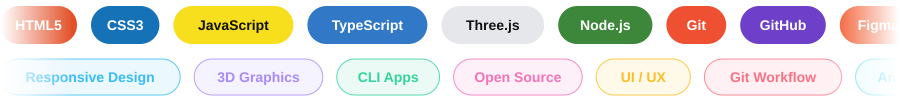

<div align="center">



<br/>


</div>

## 🚀 About Me

<div align="center">


</div>

```js
const me = {
  github: "dilandakopit19",
  location: "Malang, East Java 🇮🇩",
  loves: ["Three.js", "Creative coding", "Building things that move"],
  currentlyLearning: ["TypeScript", "Git workflows", "Clean architecture"],
  funFact: "I build entire solar systems in the browser 🪐",
  openTo: "Collaborations & new ideas"
};
```

<div align="center">

</div>

## 🛠️ Tech Arsenal

<div align="center">

</div>

<div align="center">

</div>

## 🌌 Featured Projects

<table align="center">
  <tr>
    <td align="center" width="50%">
      <a href="https://github.com/dilandakopit19/INTERACTIVE-GALAXY-">
        
      </a>
    </td>
    <td align="center" width="50%">
      <a href="https://github.com/dilandakopit19/INTERACTIVE-GALAXY-V2">
        
      </a>
    </td>
  </tr>
  <tr>
    <td align="center" width="50%">
      <a href="https://github.com/dilandakopit19/CLI-LAUNDRY-DEWE-MALANG-24-JAM">
        
      </a>
    </td>
    <td align="center" width="50%">
      <a href="https://github.com/dilandakopit19/praktikum-git-trpl-dylanleonaldo">
        
      </a>
    </td>
  </tr>
</table>

<details>
<summary><b>🪐 Click to explore: what's inside Interactive Galaxy?</b></summary>
<br/>

- ☀️ 3D solar system with real-time planetary orbits
- ☄️ Asteroid belts and visual effects
- 🎛️ Custom UI controls to play with the simulation
- ⚡ Built with HTML + Three.js

</details>

<details>
<summary><b>🧺 Click to explore: what's inside CLI Laundry?</b></summary>
<br/>

- 💻 Laundry management system that runs in the terminal
- 🕐 Designed around a 24-hour laundry business
- ⚙️ Built with JavaScript

</details>

<div align="center">

</div>

## 📊 GitHub Stats

<div align="center">


<br/>


<br/>


</div>

<details>
<summary><b>🏆 Click to see trophies</b></summary>
<br/>
<div align="center">

[](https://github.com/ryo-ma/github-profile-trophy)

</div>
</details>

<div align="center">

</div>

## 🐍 Contribution Snake

<div align="center">


</div>

## 💬 Let's Connect

<div align="center">

[](https://github.com/dilandakopit19)
[](https://instagram.com/USERNAME_KAMU)
[](https://linkedin.com/in/USERNAME_KAMU)
[](mailto:EMAIL_KAMU@gmail.com)

<br/>

⭐ *Like my projects? Drop a star and say hi!* ⭐

</div>


